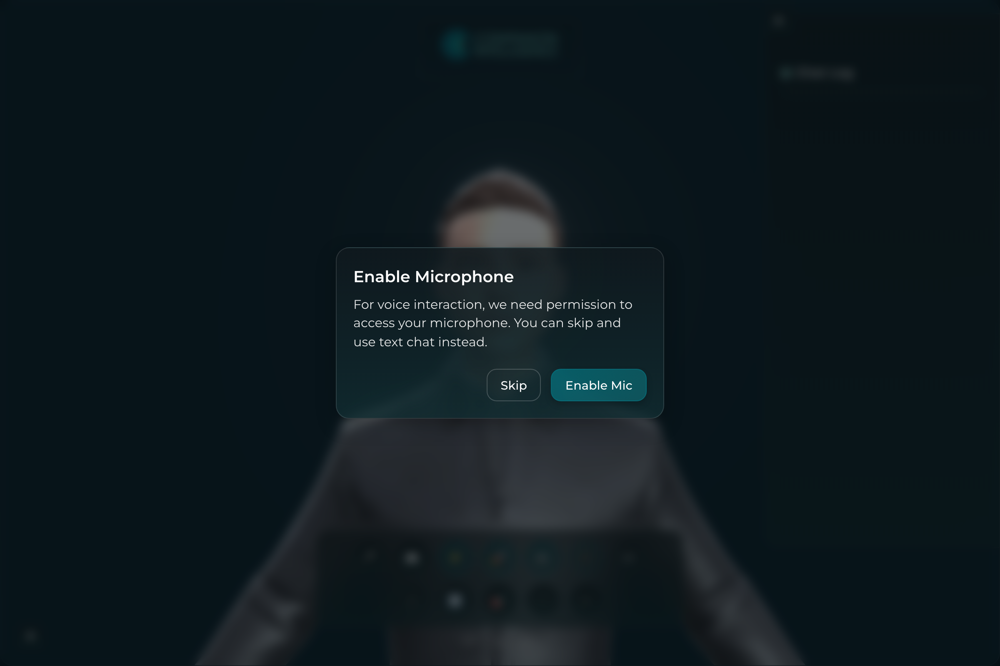
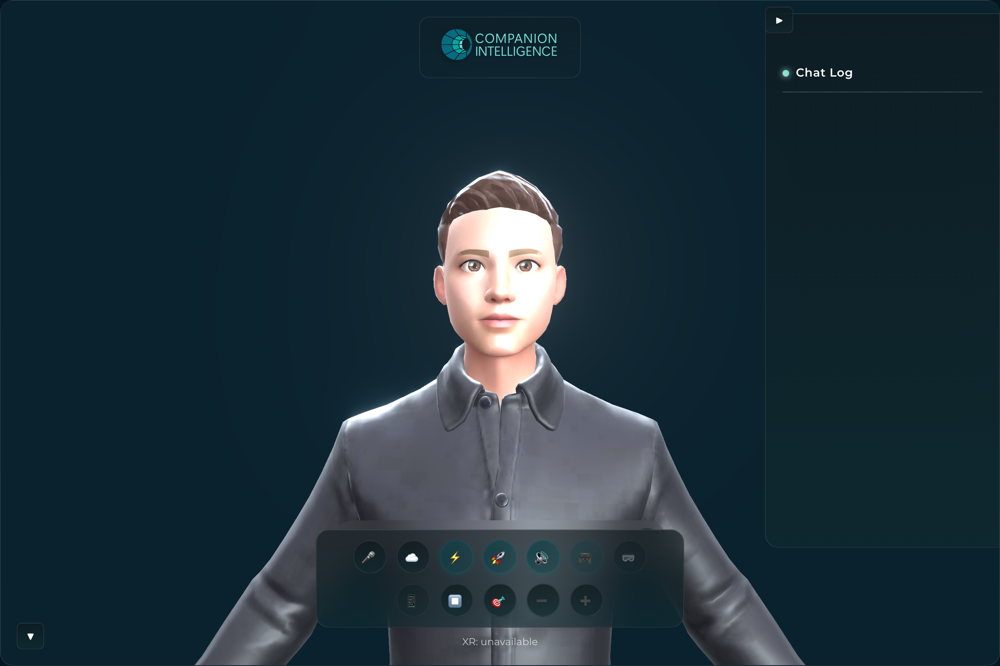
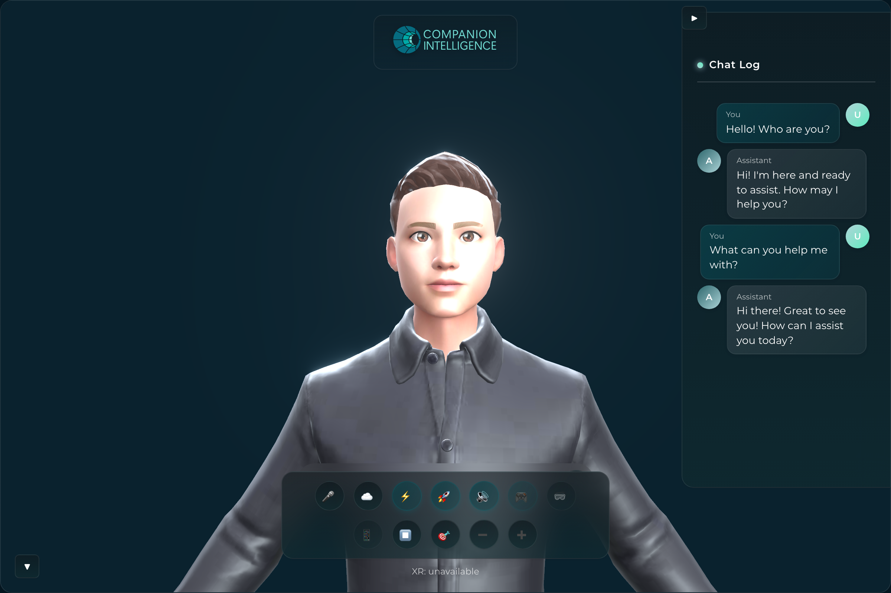
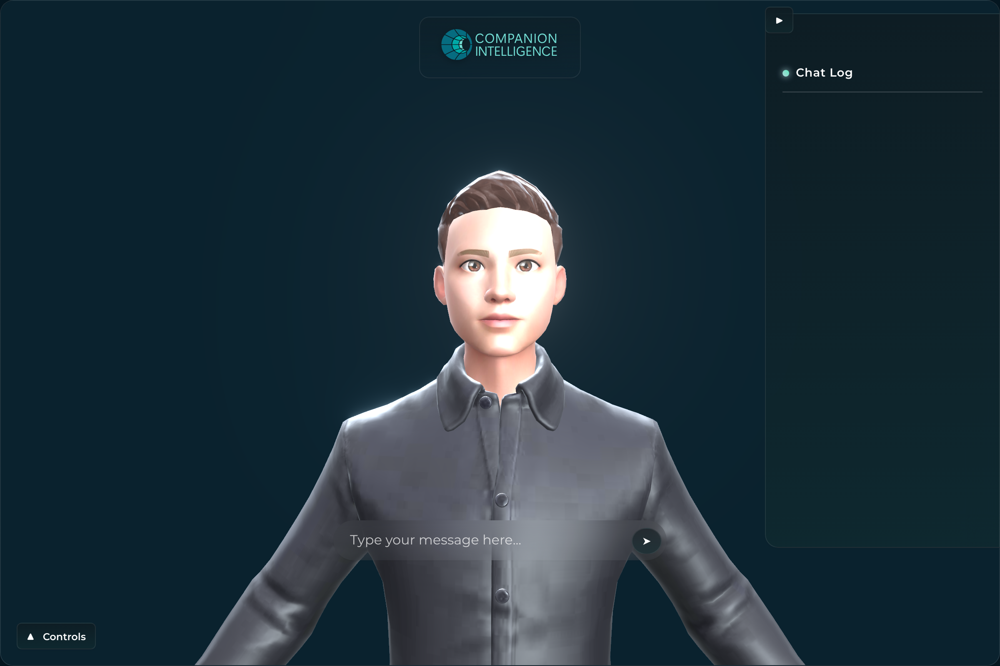

# CI Spatial Companion

WebXR and WebSpatial

Embodied AI Avatar framework with WebXR and Vision Pro support.

## Documentation

**Start here — system reference** (how it all works, with mermaid charts):

| Doc | What it covers |
|---|---|
| [architecture.md](docs/architecture.md) | The embodied agent end-to-end — pipeline, conversation-turn sequence, `useAgent` service graph, platform/render tiers, deployment |
| [animation.md](docs/animation.md) | The body **animation mixer**, the full clip/expression library (33 GLB + 6 VRMA), and **how the LLM triggers animations** |
| [avatar.md](docs/avatar.md) | Avatar **rig contract**, the viseme + emote face systems, facial capability tiers, the 24-avatar catalog, and the HumGen→VRM pipeline |
| 🎞 [**Visual-test gallery**](docs/visual-tests/) | **93 animated WebP clips** across 6 avatars (male + female · GLB + VRM) in sub-pages — [body animations](docs/visual-tests/animations.md), [faces](docs/visual-tests/faces.md) (lip-sync + emotes), [eye movement](docs/visual-tests/eyes.md), [blend combos](docs/visual-tests/blends.md) — rendered inline on GitHub |

**Pipelines & plans:**

| Doc | What it covers |
|---|---|
| [ANIMATION-PIPELINE.md](docs/ANIMATION-PIPELINE.md) | The body-animation pipeline + the RPM/Mixamo clip library |
| [AVATAR-PIPELINE.md](docs/AVATAR-PIPELINE.md) | Avatar pipeline + the rig contract in depth |
| [VOICE-PIPELINE.md](docs/VOICE-PIPELINE.md) | STT → LLM → TTS voice pipeline + lip-sync (VibeVoice / CosyVoice) |
| [FACIAL-ANIMATION-PLAN.md](docs/FACIAL-ANIMATION-PLAN.md) | Tiered facial animation (VRM → ARKit → FACS → **MetaHuman** roadmap) |
| [WEBSPATIAL-PLAN.md](docs/WEBSPATIAL-PLAN.md) | WebSpatial / spatial-platform support (visionOS, Android XR, Pico) |
| [TESTING-PIPELINE.md](docs/TESTING-PIPELINE.md) | The 5-layer test strategy (unit → visual WebP → E2E) |
| [ASSET-PIPELINE.md](docs/ASSET-PIPELINE.md) · [DEPLOYMENT.md](docs/DEPLOYMENT.md) · [DRIVE-ASSETS.md](docs/DRIVE-ASSETS.md) · [PRODUCT-PLAN.md](docs/PRODUCT-PLAN.md) · [BUTTON-AUDIT.md](docs/BUTTON-AUDIT.md) | Asset packaging · container deployment · owned-asset inventory · product/launch plan · control-bar audit |

## Interface

The app is a full-viewport **3D avatar viewport** with a 2D HUD — logo, chat-log
panel, chat input, and a floating control dock — composited on top. The shell is
intentionally **dark-only**: it is an XR HUD, not a light-themable document
surface, so the canon dark background (`--teal-950` `#041620`) is kept even under a
light OS preference. It is on the [Companion Intelligence design system](https://github.com/companionintelligence/CI-Common/tree/main/style):
teal `--primary` (`#0f717a` / hover `#abd4d8`) and Montserrat, sourced from the shared
`:root` / `.dark` tokens in `packages/core/src/styles/globals.css`. The design system
ships both light and dark palettes; this XR HUD deliberately renders the **dark**
tokens only.

All screenshots below are the **real UI rendered headlessly** (WebGL via
`chrome-headless-shell`/SwiftShader). With no LLM/TTS backend configured the app
falls back to the offline scripted (`script`) LLM provider, so the avatar, control
dock, and chat conversation all render out of the box — no backend needed for any
screen here. XR (AR/VR) session entry and speech audio require a headset / native
runtime and are **not** exercised in these captures (the dock reports
`XR: unavailable` under headless Chromium); see the note at the end of this section.

### First-run onboarding

The microphone-permission modal shown on first load (before `ci_avatar_onboarded`
is set in `localStorage`), layered over the live avatar scene. "Skip" drops
straight into text chat.



### HUD shell

The default state once onboarding is dismissed: the Companion Intelligence logo, the
VRM avatar, the collapsible **Chat Log** panel (empty), the floating control dock,
and the live `XR:` status line.



### Chat conversation

The **Chat Log** populated by a real exchange with the offline scripted provider —
`You` / `Assistant` bubbles rendered with the canon teal gradient. No LLM backend
is running; the responses come from the bundled directed-response set.



### Controls collapsed

With the control dock hidden via its **Controls** toggle (bottom-left), the HUD
reduces to the logo, Chat Log, and the exposed `Type your message here…` chat
input — the minimal text-only interaction surface.



> **Backend / native-runtime-gated surfaces (not captured):** entering an immersive
> **AR/VR session** requires a WebXR-capable headset (the 🥽 / 📱 dock buttons and
> the XR recenter/scale/exit controls only activate inside a session), the **Vision
> Pro** WebSpatial build (`apps/vision-pro`) needs visionOS, and **voice** (mic VAD →
> STT → TTS lip-sync) and **cloud/WebGPU** modes need device permissions or a
> reachable backend. Those states are not fabricated here; only what genuinely
> renders headlessly is shown.

## Structure

```
├── packages/
│   └── core/           # Shared services, components, and utilities
├── apps/
│   ├── web/            # Standard web application
│   └── vision-pro/     # Apple Vision Pro (WebSpatial) application
```

## Development

```bash
# Install dependencies
pnpm install

# Start web dev server
pnpm dev:web

# Start Vision Pro dev server
pnpm dev:vision
```

## Docker / CI Hub

A public multi-arch (amd64 + arm64) image is published to GHCR and used by the CI Hub
app store as **Avatar Companion**. nginx serves the built web app on internal port **5173**.

```bash
docker run -d -p 8080:5173 ghcr.io/companionintelligence/ci-spatial-companion-webxr:latest
# open http://localhost:8080
```

The published image is fully self-contained: with no LLM/TTS backend configured it
falls back to offline scripted responses (`script` provider), so the avatar, chat,
and animations work out of the box. Speech audio is disabled unless a TTS backend
is reachable.

### Connecting an LLM/TTS backend

Vite environment variables are **baked in at build time** — setting them on
`docker run` has no effect. To produce an image wired to a backend, pass build args:

```bash
docker build \
  --build-arg VITE_LLM_PROVIDER=ollama \
  --build-arg VITE_LLM_OLLAMA_API_URL=https://ollama.example.com \
  --build-arg VITE_LLM_OLLAMA_MODEL=gemma3:1b \
  -t avatar-companion .
```

| Build arg / env           | Default                 | Purpose                                                     |
| ------------------------- | ----------------------- | ----------------------------------------------------------- |
| `VITE_LLM_PROVIDER`       | `script`                | `script`, `ollama`, `mlc` (in-browser WebLLM), or `openai`  |
| `VITE_LLM_OLLAMA_API_URL` | —                       | Ollama server URL (required for `ollama`)                   |
| `VITE_LLM_OLLAMA_MODEL`   | `gemma3:1b`             | Ollama model name                                           |
| `VITE_TTS_MODE`           | `pocket`                | `pocket`, `browser` (speechSynthesis), `local`, or `remote` |
| `VITE_POCKET_TTS_URL`     | `http://localhost:8000` | Pocket TTS server URL                                       |

Note: the LLM/TTS requests are made from the **browser**, not the container, so the
backend URL must be reachable from the user's machine and must allow the app's
origin via CORS (for Ollama set `OLLAMA_ORIGINS`, see `pnpm ollama:serve`).

## Core Features

- **3D Avatar System**: VRM-based avatars with emotion and speech animation
- **LLM Integration**: Local (WebLLM, Ollama) and cloud backends
- **Voice Pipeline**: STT → LLM → TTS with viseme lip sync
- **WebXR Support**: AR/VR experiences via @react-three/xr
- **WebGPU Rendering**: Optional high-performance rendering

## Architecture

### Services

- `llm/` - Language model integration (WebLLM, Ollama, Cloud APIs)
- `tts/` - Text-to-speech with VITS
- `stt/` - Speech-to-text with Whisper
- `vad/` - Voice activity detection
- `viseme/` - Lip sync viseme generation
- `emote/` - Facial expression system
- `animation/` - Body animation system

### Components

- `scene/` - 3D scene and avatar rendering
- `chat/` - Chat UI components
- `control/` - Settings and control panels

## License

Copyright Companion Intelligence - LifeScope Inc. Private and confidential.
