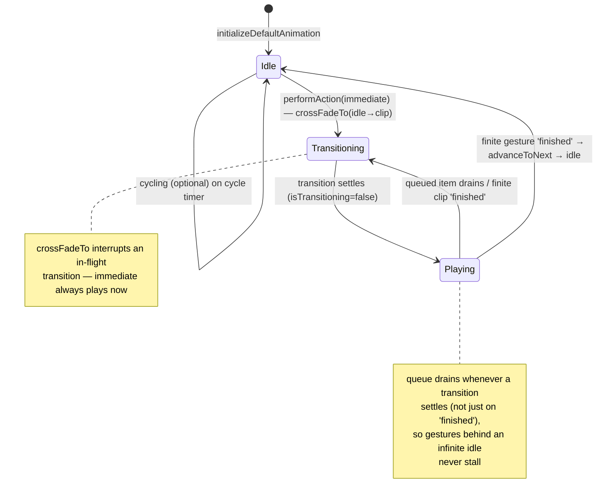
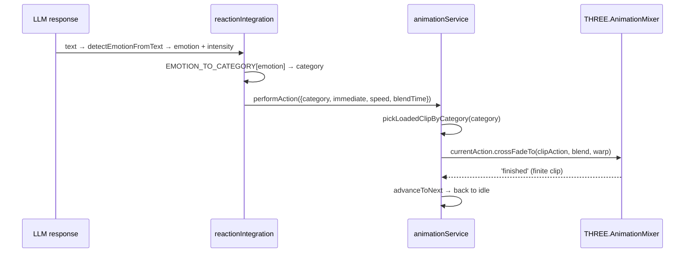

# Animation — The Body Mixer & Expression Library

The **body** puppetry system: a state machine over `THREE.AnimationMixer` that plays and
blends a library of clips, plus the map of every expression and **how the LLM triggers
them**. Faces (visemes/emotes) are in [`avatar.md`](avatar.md); the big picture is in
[`architecture.md`](architecture.md).

Code: `packages/core/src/services/animation/` — `animationService.ts` (the state machine),
`config/animationClips.ts` (the catalog), `config/personalityConfig.ts` (cycling weights),
`useAnimationService.ts` (React hook). Clips are the shared `assets/animations/*.glb`.

## How the mixer works

Blending is delegated to three.js' native `AnimationAction.crossFadeTo` (with time-warp);
clip completion is driven by the mixer's `'finished'` event. One clip is "current"; a
one-shot gesture crossfades in over the base idle and returns to idle when it finishes.



### The queue (why "mixing" now works)

A performance is either **immediate** (plays now, crossfading from whatever is current) or
**queued**. Queued items advance when:

1. a **finite** clip fires the mixer `'finished'` event, **or**
2. **any** transition settles and the queue is non-empty (`updateAnimation` drains it), **or**
3. personality **cycling** is enabled (off by default).

> Rule 2 is the fix for *"mixing not working"*: previously a gesture queued behind an
> **infinite** idle (which never fires `'finished'`) sat in the queue forever. Now the
> update loop drains it, `immediate` performances interrupt cleanly, and re-triggering a
> finite gesture replays it. Regression-tested in `animationService.node.test.ts`.



## The expression library (full catalog)

Two catalogs, chosen by the active avatar's skeleton (`getAvatarCatalog(isVRM)`):
**GLB clips** for RPM/Mixamo/HumGen GLB skeletons, **VRMA clips** for VRM humanoids.
Durations are read from the real clip at load; `∞` = looping (`loopCount: Infinity`).

### GLB clips (33) — `GLB_CLIPS`

| Clip | Category | Loop | Blend ms | Speed | Notes |
|---|---|---|---|---|---|
| `idle-stable` | idle | ∞ | 1000 | 1 | default idle (priority 1) |
| `basic-idle` | idle | ∞ | 1000 | 1 | |
| `standing-idle-watch` | idle | ∞ | 1000 | 1 | |
| `Talking` · `Talking-1` · `Talking-2` | communication | 1 | 500 | 1 | talking beats |
| `Telling-A-Secret` | communication | 1 | 500 | 1 | |
| `Waving` | gesture | 1 | 500 | 0.9 | greet |
| `Arm-Gesture` · `Head-Gesture` | gesture | 1 | 500 | 1 | |
| `Happy-Hand-Gesture` | gesture | 1 | 500 | 1 | |
| `Hands-Forward-Gesture` | gesture | 1 | 500 | 0.9 | |
| `Whatever-Gesture` | gesture | 1 | 500 | 1 | |
| `Clapping` | gesture | 1 | 450 | 1 | |
| `Pointing-Forward` | gesture | 1 | 500 | 1 | wayfinding |
| `Salute` | gesture | 1 | 500 | 1 | |
| `Shoulder-Rubbing` · `Agreeing` | gesture | 1 | 500 | 1 | |
| `Surprised` · `Reacting` | expression | 1 | 400–500 | 1 | reactions |
| `Thinking` | expression | 1 | 600 | 0.9 | |
| `Looking` · `Looking-1` · `Looking-Behind` | expression | 1 | 600 | 1 | |
| `Shaking-It-Off` | expression | 1 | 450 | 1 | |
| `Cocky-Head-Turn` | expression | 1 | 500 | 1 | |
| `dance` · `dance-action` | action | 1 | 800 | 1 | priority 5 |
| `bow` · `throw` | action | 1 | 500–600 | 1 | |
| `Praying` · `Spin-In-Place` · `Crazy-Gesture` | action | 1 | 500–600 | 1 | |
| `walking` | movement | ∞ | 400 | 1 | locomotion base |

### VRMA clips (6) — `VRMA_CLIPS`

| Clip | Category | Loop |
|---|---|---|
| `idle_loop` | idle | ∞ |
| `surprise_greet` · `pose` | gesture | 1 |
| `victory_sign` · `finger_gun` · `dance_move` | action | 1 |

Categories: `idle · communication · gesture · expression · action · movement`.

## How to call animations with the LLM

### 1. Automatic (the default) — emotion → gesture

Every LLM response runs through `createReactionFromMessage(text)`, which detects an
emotion and maps it to an animation **category** (`reactionIntegration.EMOTION_TO_CATEGORY`).
The mixer then resolves a **loaded clip of that category** for the active avatar — so it
works for any skeleton without naming a clip.

| Emotion (from `detectEmotionFromText`) | Animation category | Example clips picked |
|---|---|---|
| `happy` | gesture | Waving, Clapping, Happy-Hand-Gesture, … |
| `love` | gesture | (gesture set) |
| `angry` | expression | Reacting, Cocky-Head-Turn, … |
| `fear` | expression | Surprised, Shaking-It-Off, … |
| `sad` | expression | Thinking, Looking, … |
| `disgust` | expression | (expression set) |
| `neutral` | — (stay in idle) | — |

`detectEmotionFromText` keys off keywords/emoji (e.g. *great/amazing/😊* → happy;
*sorry/😢* → sad; *furious/😡* → angry; *scared/😨* → fear; *gross/🤮* → disgust;
*love you/❤️* → love). `getEmotionIntensity` (*extremely/incredibly* → 0.8–1.0) modulates
playback speed (0.7–1.4×) and blend time.

**So: to make the avatar gesture, have the LLM's reply carry the emotion in its words** —
an enthusiastic reply naturally triggers a gesture; a somber one triggers an expression;
a neutral reply stays in idle. The lip-sync + facial emote fire from the same reaction.

### 2. Explicit — the performAction API

```ts
// Play a specific clip immediately, over the idle base:
animations.actions.performAction({
  clip: GLB_CLIPS['Salute'],   // or getAvatarCatalog(isVRM)[name]
  immediate: true,
  loopCount: 1,
  blendTime: 400,
  speed: 1
})

// Or by category (avatar-agnostic — resolves a loaded clip of that category):
animations.actions.performAction({ category: 'gesture', immediate: true, loopCount: 1 })

// Queue instead of interrupt (plays after the current finishes / settles):
animations.actions.performAction({ clip, immediate: false })
```

`AnimationPerformanceData`: `{ clip? | category?, immediate?, loopCount?, blendTime?, speed? }`.
Omit `immediate` to queue; the mixer drains the queue when the current transition settles.

### 3. Startup & interaction defaults

- **On load:** a greet clip (`getGreetClip`) plays, then crossfades to the looping idle.
- **Avatar click:** a random `action`-category clip + a happy emote.
- **Barge-in:** a user "stop/wait" (`shouldTriggerBargeIn`) aborts the LLM stream and relaxes the performance.

## QA — the visual gallery

Every clip is captured as a short animated **WebP** via the harness
(`apps/web/harness.html` → `e2e/capture/gen-webp.mjs`) into `docs/visual-tests/`
(**49 clips**: the full GLB catalog on Greg + the VRMA clips on a VRM avatar + lip-sync +
emotes + a blend). The gallery `index.html` is manifest-driven. Regenerate with
`node e2e/capture/gen-webp.mjs`. See [`TESTING-PIPELINE.md`](TESTING-PIPELINE.md) (layer L3).
