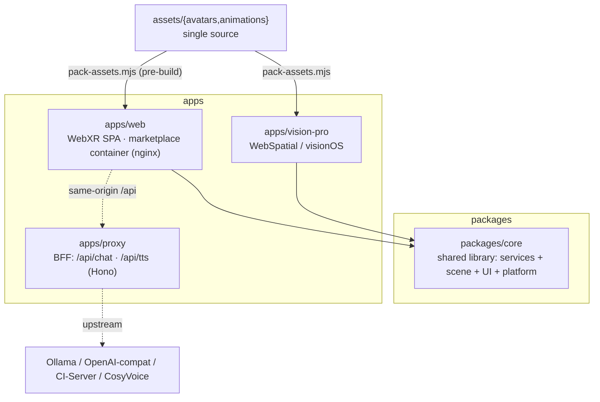
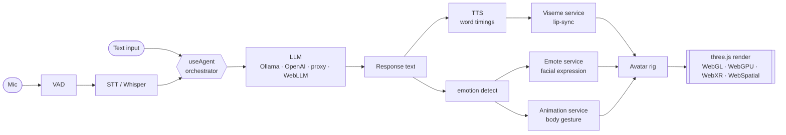
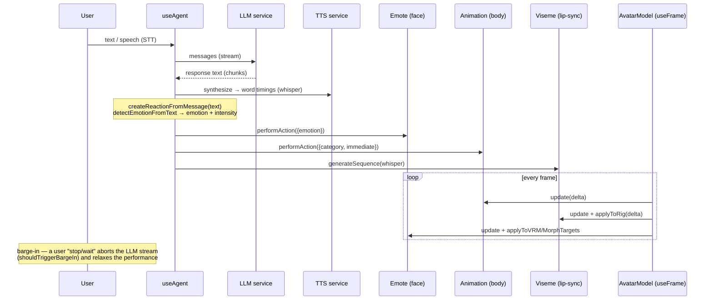
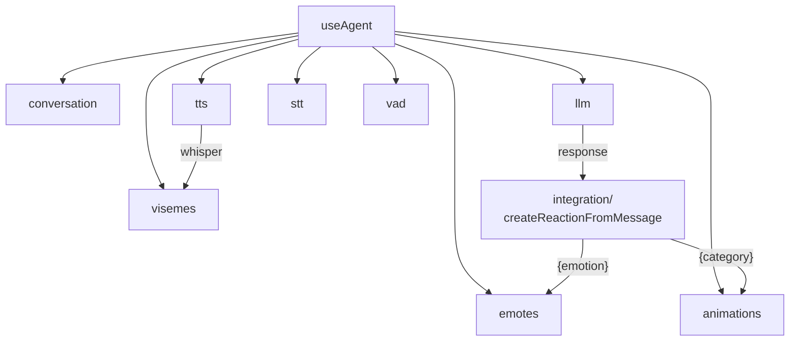
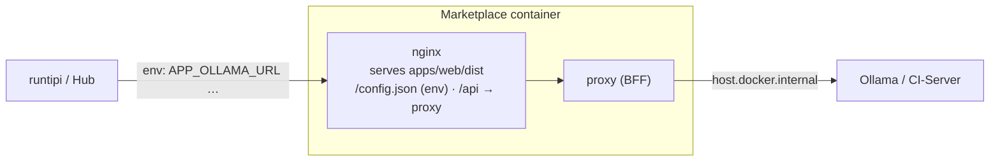

# Architecture — CI Spatial Companion (Embodied Agent)

How the whole system fits together: a talking, emoting 3D avatar you converse with, in
the browser and in XR. This doc is the map; [`animation.md`](animation.md) details the
body-animation mixer and [`avatar.md`](avatar.md) details the avatar + facial systems.

## What an "embodied agent" is here

A normal chat agent returns text. An **embodied agent** turns each response into a
performance: the avatar **speaks** (TTS), **lip-syncs** (visemes), shows a **facial
emotion** (emote), and plays a **body gesture** (animation) — rendered as a 3D character
on desktop, mobile, or a spatial headset. Two puppetry systems run in parallel: one for
the **face** (visemes + emotes), one for the **body** (the animation mixer).

## Monorepo

| Package / App | Stack | Role |
|---|---|---|
| `packages/core` | React 19 · three.js · @react-three/fiber · @pixiv/three-vrm | All services, the 3D scene, UI components, platform tiers — consumed by every app |
| `apps/web` | Vite 6 · nginx | The WebXR SPA; built into the marketplace container |
| `apps/vision-pro` | Vite · `@webspatial/*` | Native spatial build (visionOS; Android XR / Pico roadmap) |
| `apps/proxy` | Hono · Node ≥20 | Same-origin BFF that streams chat + TTS from a configurable upstream, keeping keys server-side |

## The embodied-agent pipeline

## A conversation turn (sequence)

The load-bearing wiring lives in `useAgent.ts`: on each response it builds a reaction and
drives all three puppetry services.

## Service orchestration

`useAgent(config)` instantiates and wires every service; components read the resolved
services off it. All services are pure state machines updated per-frame from `AvatarModel`.

| Service | Module | Responsibility |
|---|---|---|
| LLM | `services/llm` | Chat completion (Ollama / OpenAI-compat / same-origin proxy / in-browser WebLLM); `AbortController` cancellation for barge-in |
| TTS | `services/tts` | Speech synthesis + word/viseme timings (`whisper` data) that drive lip-sync |
| STT | `services/stt` | Whisper transcription of mic input |
| VAD | `services/vad` | Voice-activity detection to gate STT |
| Viseme | `services/visemes` | `whisper → sequence → rig`; 14 Oculus visemes (GLB) or 5 VRM mouth expressions — see [avatar.md](avatar.md#face-visemes--lip-sync) |
| Emote | `services/emote` | Emotion → facial morphs/expressions + blink/gaze/ticks + barge-in relax |
| Animation | `services/animation` | The body **mixer** — crossfade, queue, personality cycling — see [animation.md](animation.md) |
| Conversation | `services/conversation` | Message history |
| **Agent** | `services/useAgent` | Orchestrates all of the above into one `agent` object |

## Rendering & platform

`Scene3D` mounts `AvatarModel` inside an `@react-three/xr` session; `packages/core/src/platform`
detects the **surface** and picks a render preset (see [WEBSPATIAL-PLAN.md](WEBSPATIAL-PLAN.md)).

| Surface | Detect | Render preset (DPR · shadows · post · foveation · WebGPU · fps) |
|---|---|---|
| desktop | default | 2 · soft · high · 0 · yes · 60 |
| mobile-ios / android | UA | 1.5 · none · low · 0 · no · 30 |
| quest | `OculusBrowser` | 1.2 · none · off · 1.0 · no · 72 |
| vision-pro | `visionOS\|WebSpatial` | 1.0 · none · medium · 0.5 · yes · 90 |

Rendering is WebGL by default; a WebGPU path (`MToonNodeMaterial`, `useHasWebGPU`) is
gated per surface. XR uses WebXR in the browser and WebSpatial in the native builds.

## Deployment

Runtime config is generated from env into `/config.json` at container start (no rebuild to
retarget an LLM), merged as `localStorage > /config.json > build-time defaults`.

## Where to look next

- **Body animation + the mixer + calling animations from the LLM** → [`animation.md`](animation.md)
- **Avatars, the rig contract, visemes/emotes, facial tiers, the HumGen→VRM pipeline** → [`avatar.md`](avatar.md)
- **Testing (unit → visual WebP → E2E)** → [`TESTING-PIPELINE.md`](TESTING-PIPELINE.md)
