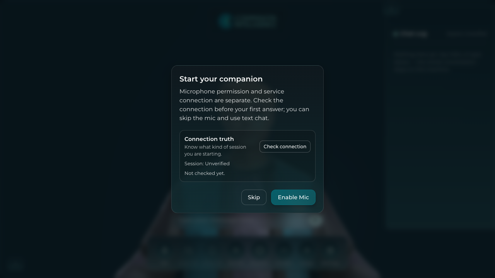
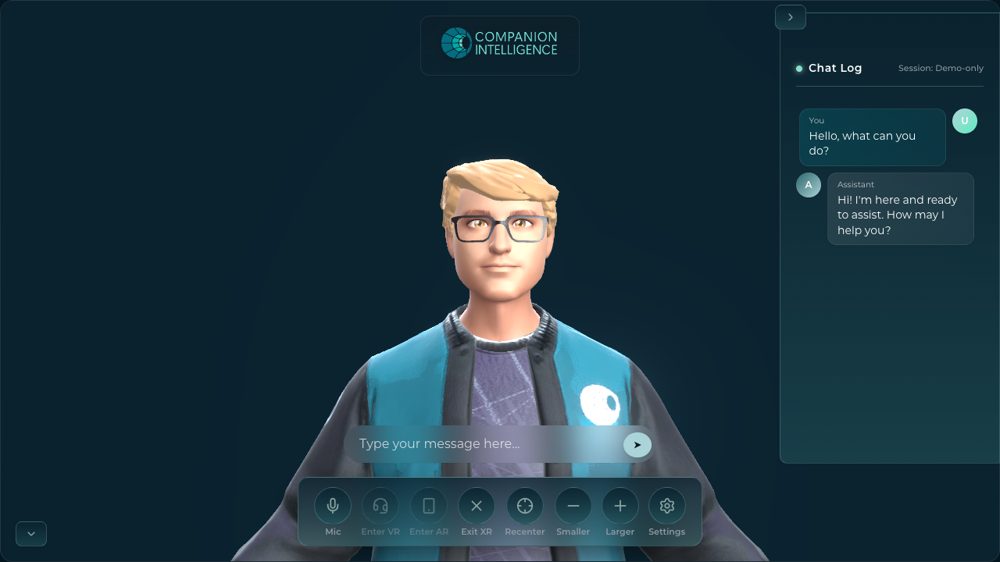
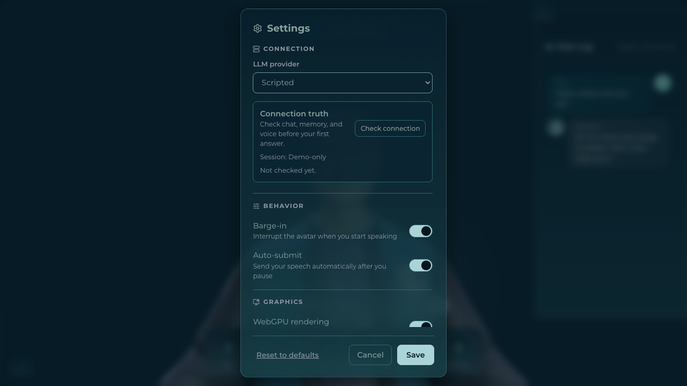

# Spatial Companion demo evidence

This folder contains a short, reproducible demo of the canonical web surface
plus the stills used to review its activation journey.

## Canonical system demo

- [MP4 demo reel](ci-spatial-companion-system-demo.mp4) · about 20 seconds · 1280×720
- [WebM source](ci-spatial-companion-system-demo.webm)
- [Capture manifest](manifest.json)

The capture runs the real web app in deterministic `script` mode and records:

1. Fresh onboarding with `Session: Unverified`.
2. Explicit `demo-only` activation after skipping voice setup.
3. A first visible companion response in the Chat Log.
4. Settings → **Connection truth**.
5. A second visible turn after returning to the main surface.

The recording is silent. It proves canonical app boot, avatar rendering,
activation labeling, text conversation, and the Settings truth surface. It does
not claim live CI-Server memory, grounded provenance, TTS reachability, XR
runtime support, or autonomous actions.

Regenerate it with a running web dev server:

```bash
BASE_URL=http://127.0.0.1:5199 pnpm generate:system-demo
```

## Stills







The complete sequence is listed in [`manifest.json`](manifest.json).

## Avatar embodiment media

The separate [visual-test gallery](../visual-tests/README.md) contains the
real avatar harness captures. The curated MP4/WebM clips and PNG stills under
`docs/visual-tests/videos/` and `docs/visual-tests/shots/` cover idle breathing,
talking, waving, dance, emotion, surprise, and synthetic lip-sync.

Those harness artifacts prove the shipped animation, emote, and viseme services
on the instrumented surface. They are complementary to the canonical system
demo and are not evidence of memory or tool behavior.
