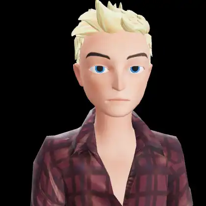

# Avatar Visual Tests — WebP Gallery

**49 animated WebP clips** captured from the real avatar rig via the capture
harness (`apps/web/harness.html` → `e2e/capture/gen-webp.mjs`) at 9 fps — a
faithful record of the shipping animation / viseme / emote services across the full mixer
catalog. GitHub renders these inline; regenerate with `node e2e/capture/gen-webp.mjs`.

See [`../animation.md`](../animation.md) for the clip catalog + how the LLM triggers
animations, and [`../TESTING-PIPELINE.md`](../TESTING-PIPELINE.md) (layer L3) for how these
are produced.

## Visemes / lip-sync · 2

<table>
  <tr>
    <td align="center"> Lip-sync visemes (GLB · Greg)</td>
    <td align="center"> Lip-sync visemes (VRM · Erik)</td>
  </tr>
</table>

## Expression / emote · 6

<table>
  <tr>
    <td align="center"> Emote: happy (GLB · Greg)</td>
    <td align="center"> Emote: sad (GLB · Greg)</td>
    <td align="center"> Emote: angry (GLB · Greg)</td>
  </tr>
  <tr>
    <td align="center"> Emote: fear (GLB · Greg)</td>
    <td align="center"> Emote: love (GLB · Greg)</td>
    <td align="center"> Emote: neutral (GLB · Greg)</td>
  </tr>
</table>

## Body — idle · 3

<table>
  <tr>
    <td align="center"> idle-stable (idle)</td>
    <td align="center"> basic-idle (idle)</td>
    <td align="center"> standing-idle-watch (idle)</td>
  </tr>
</table>

## Body — communication · 4

<table>
  <tr>
    <td align="center"> Talking (communication)</td>
    <td align="center"> Talking-1 (communication)</td>
    <td align="center"> Talking-2 (communication)</td>
  </tr>
  <tr>
    <td align="center"> Telling-A-Secret (communication)</td>
  </tr>
</table>

## Body — gesture · 11

<table>
  <tr>
    <td align="center"> Waving (gesture)</td>
    <td align="center"> Arm-Gesture (gesture)</td>
    <td align="center"> Head-Gesture (gesture)</td>
  </tr>
  <tr>
    <td align="center"> Happy-Hand-Gesture (gesture)</td>
    <td align="center"> Hands-Forward-Gesture (gesture)</td>
    <td align="center"> Whatever-Gesture (gesture)</td>
  </tr>
  <tr>
    <td align="center"> Clapping (gesture)</td>
    <td align="center"> Pointing-Forward (gesture)</td>
    <td align="center"> Salute (gesture)</td>
  </tr>
  <tr>
    <td align="center"> Shoulder-Rubbing (gesture)</td>
    <td align="center"> Agreeing (gesture)</td>
  </tr>
</table>

## Body — expression / reaction · 8

<table>
  <tr>
    <td align="center"> Surprised (expression)</td>
    <td align="center"> Reacting (expression)</td>
    <td align="center"> Thinking (expression)</td>
  </tr>
  <tr>
    <td align="center"> Looking (expression)</td>
    <td align="center"> Looking-1 (expression)</td>
    <td align="center"> Looking-Behind (expression)</td>
  </tr>
  <tr>
    <td align="center"> Shaking-It-Off (expression)</td>
    <td align="center"> Cocky-Head-Turn (expression)</td>
  </tr>
</table>

## Body — action · 7

<table>
  <tr>
    <td align="center"> dance (action)</td>
    <td align="center"> dance-action (action)</td>
    <td align="center"> bow (action)</td>
  </tr>
  <tr>
    <td align="center"> throw (action)</td>
    <td align="center"> Praying (action)</td>
    <td align="center"> Spin-In-Place (action)</td>
  </tr>
  <tr>
    <td align="center"> Crazy-Gesture (action)</td>
  </tr>
</table>

## Body — movement · 1

<table>
  <tr>
    <td align="center"> walking (movement)</td>
  </tr>
</table>

## VRM body animation (VRMA) · 6

<table>
  <tr>
    <td align="center"> idle_loop (vrma)</td>
    <td align="center"> victory_sign (vrma)</td>
    <td align="center"> surprise_greet (vrma)</td>
  </tr>
  <tr>
    <td align="center"> pose (vrma)</td>
    <td align="center"> finger_gun (vrma)</td>
    <td align="center"> dance_move (vrma)</td>
  </tr>
</table>

## Blend / crossfade · 1

<table>
  <tr>
    <td align="center"> idle → wave → idle crossfade (GLB · Greg)</td>
  </tr>
</table>

---
_Generated from `manifest.json` by `e2e/capture/gallery-md.mjs`._
