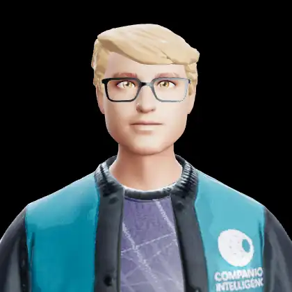

# Avatar Visual Tests — WebP Gallery

**31 animated WebP clips** captured from the real avatar rig via the harness
(`apps/web/harness.html` → `e2e/capture/gen-webp.mjs`) at 10 fps — a faithful
record of the shipping animation / viseme / emote services across **male + female avatars on
GLB and VRM rigs**. GitHub renders these inline. Regenerate: `node e2e/capture/gen-webp.mjs`.

See [`../animation.md`](../animation.md) (mixer + clip catalog) and
[`../avatar.md`](../avatar.md) (rigs + faces).

## Sub-pages

| Page | Clips | What |
|---|---|---|
| 🎞 [**Faces — Lip-sync & Emotes**](faces.md) | 24 | Viseme lip-sync + emotion expressions — GLB avatars (ARKit-52 morphs) and the expressive VRM avatars (Yuki, Kenji). Realistic VRM imports with empty expression binds are body-only. |
| 🎞 [**Eye Movement**](eyes.md) | 2 | Deterministic gaze — left, right, up, down, wide — plus blinks, driven one pose per frame through the ARKit eye morphs (eyeLook*, eyeBlink*, eyeWide*). |
| 🎞 [**Blend Combos**](blends.md) | 5 | Native crossfade transitions between clips (idle → gesture → idle, gesture → action, …). |

## Highlights

<table>
  <tr>
    <td align="center"> Lip-sync — Greg (M·GLB)</td>
    <td align="center"> Emote: happy — Yuki (F·VRM)</td>
    <td align="center"> Eye movement — gaze L/R/up/down + blink (Greg)</td>
  </tr>
</table>

---
_Generated from `manifest.json` by `e2e/capture/gallery-md.mjs`._
