# Body Animations · 67

The full body-animation catalog played through the real mixer, across male + female avatars on both GLB and VRM rigs. Female GLB avatars use the **feminine motion set** (female-actor mocap: F_ idle/talking/dance from the RPM animation library) — masculine and feminine avatars move differently.

← [back to gallery index](README.md)

### Greg · M·GLB · 31

**idle**

<table>
  <tr>
    <td align="center"> basic-idle — Greg (M·GLB)</td>
  </tr>
</table>

**communication**

<table>
  <tr>
    <td align="center"> Talking — Greg (M·GLB)</td>
    <td align="center"> Talking-1 — Greg (M·GLB)</td>
    <td align="center"> Talking-2 — Greg (M·GLB)</td>
  </tr>
  <tr>
    <td align="center"> Telling-A-Secret — Greg (M·GLB)</td>
  </tr>
</table>

**gesture**

<table>
  <tr>
    <td align="center"> Waving — Greg (M·GLB)</td>
    <td align="center"> Arm-Gesture — Greg (M·GLB)</td>
    <td align="center"> Head-Gesture — Greg (M·GLB)</td>
  </tr>
  <tr>
    <td align="center"> Happy-Hand-Gesture — Greg (M·GLB)</td>
    <td align="center"> Hands-Forward-Gesture — Greg (M·GLB)</td>
    <td align="center"> Whatever-Gesture — Greg (M·GLB)</td>
  </tr>
  <tr>
    <td align="center"> Clapping — Greg (M·GLB)</td>
    <td align="center"> Pointing-Forward — Greg (M·GLB)</td>
    <td align="center"> Salute — Greg (M·GLB)</td>
  </tr>
  <tr>
    <td align="center"> Shoulder-Rubbing — Greg (M·GLB)</td>
    <td align="center"> Agreeing — Greg (M·GLB)</td>
  </tr>
</table>

**expression**

<table>
  <tr>
    <td align="center"> Surprised — Greg (M·GLB)</td>
    <td align="center"> Reacting — Greg (M·GLB)</td>
    <td align="center">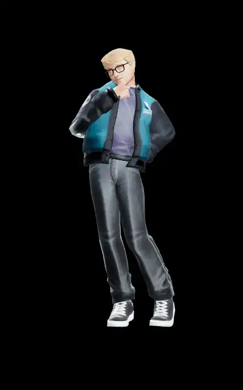 Thinking — Greg (M·GLB)</td>
  </tr>
  <tr>
    <td align="center"> Looking — Greg (M·GLB)</td>
    <td align="center"> Looking-1 — Greg (M·GLB)</td>
    <td align="center"> Looking-Behind — Greg (M·GLB)</td>
  </tr>
  <tr>
    <td align="center">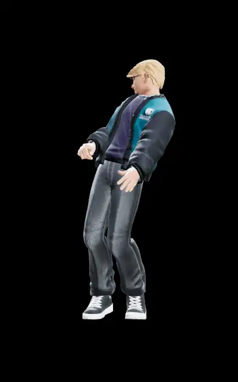 Shaking-It-Off — Greg (M·GLB)</td>
    <td align="center"> Cocky-Head-Turn — Greg (M·GLB)</td>
  </tr>
</table>

**action**

<table>
  <tr>
    <td align="center">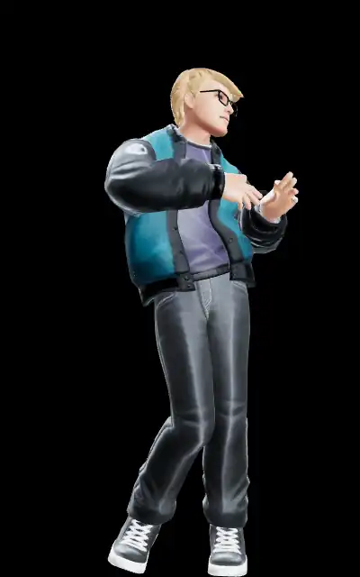 dance — Greg (M·GLB)</td>
    <td align="center"> dance-action — Greg (M·GLB)</td>
    <td align="center">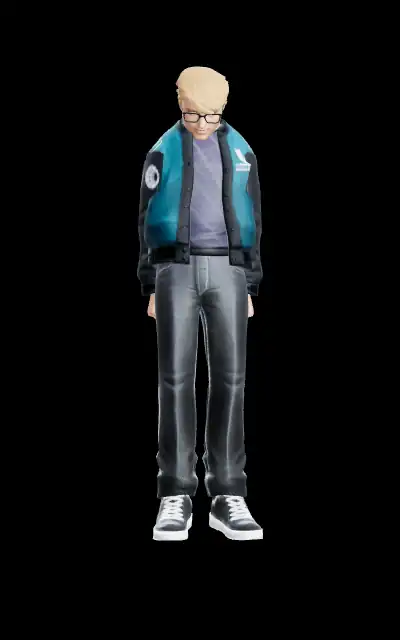 bow — Greg (M·GLB)</td>
  </tr>
  <tr>
    <td align="center"> throw — Greg (M·GLB)</td>
    <td align="center">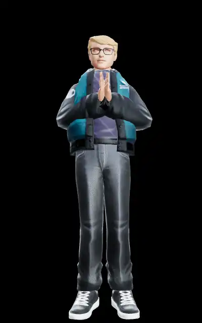 Praying — Greg (M·GLB)</td>
    <td align="center">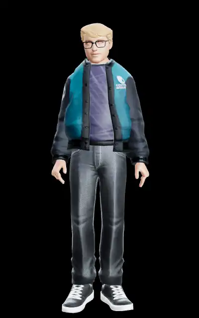 Spin-In-Place — Greg (M·GLB)</td>
  </tr>
  <tr>
    <td align="center"> Crazy-Gesture — Greg (M·GLB)</td>
  </tr>
</table>

### Cara · F·GLB · 14

**feminine**

<table>
  <tr>
    <td align="center"> F_Standing_Idle_001 — Cara (F·GLB)</td>
    <td align="center">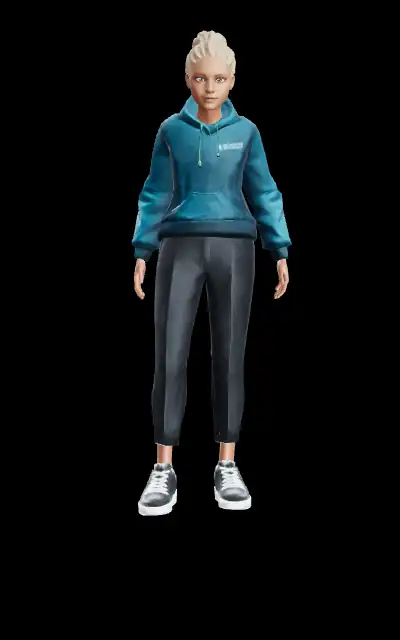 F_Standing_Idle_Variations_002 — Cara (F·GLB)</td>
    <td align="center">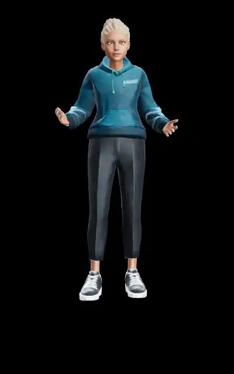 F_Talking_Variations_001 — Cara (F·GLB)</td>
  </tr>
  <tr>
    <td align="center"> F_Talking_Variations_002 — Cara (F·GLB)</td>
    <td align="center"> F_Dances_001 — Cara (F·GLB)</td>
    <td align="center">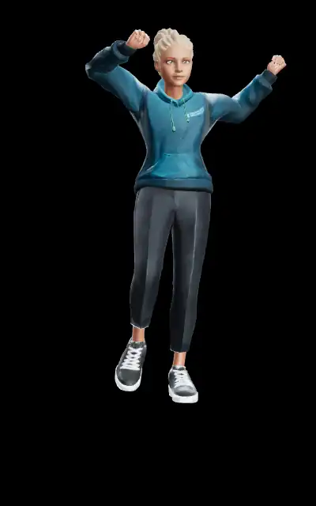 F_Dances_005 — Cara (F·GLB)</td>
  </tr>
  <tr>
    <td align="center">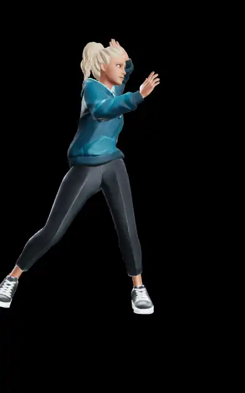 F_Dances_006 — Cara (F·GLB)</td>
  </tr>
</table>

**gesture**

<table>
  <tr>
    <td align="center">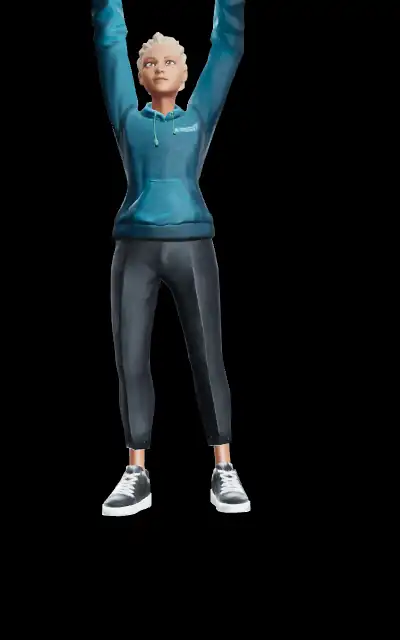 Waving — Cara (F·GLB)</td>
    <td align="center"> Clapping — Cara (F·GLB)</td>
    <td align="center">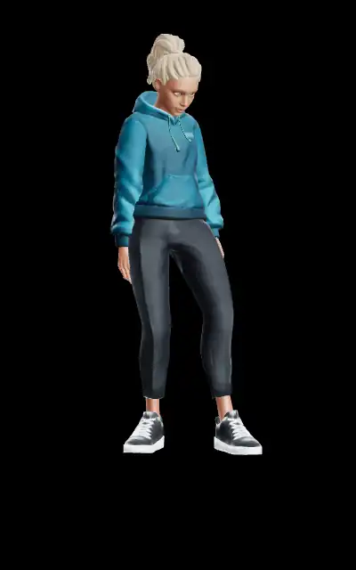 Pointing-Forward — Cara (F·GLB)</td>
  </tr>
  <tr>
    <td align="center">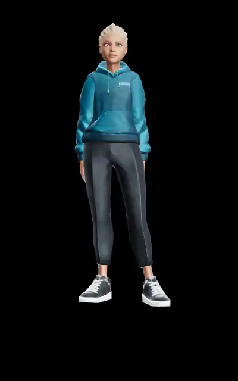 Agreeing — Cara (F·GLB)</td>
  </tr>
</table>

**expression**

<table>
  <tr>
    <td align="center">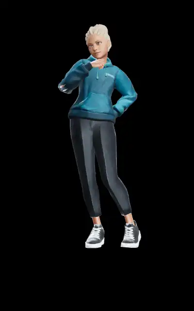 Thinking — Cara (F·GLB)</td>
    <td align="center"> Surprised — Cara (F·GLB)</td>
  </tr>
</table>

**action**

<table>
  <tr>
    <td align="center">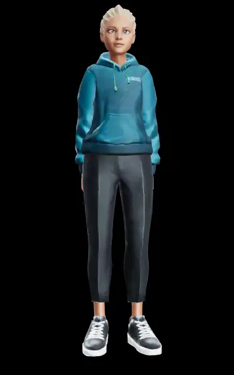 bow — Cara (F·GLB)</td>
  </tr>
</table>

### Brad · M·GLB · 10

**idle**

<table>
  <tr>
    <td align="center"> basic-idle — Brad (M·GLB)</td>
  </tr>
</table>

**communication**

<table>
  <tr>
    <td align="center">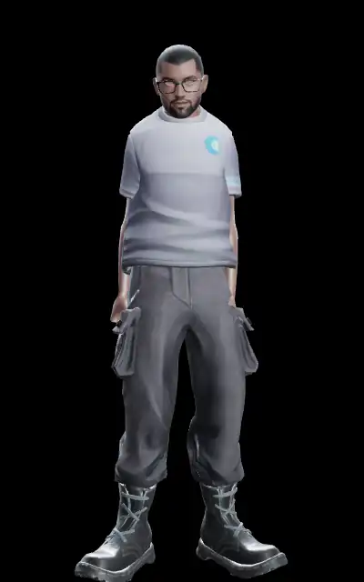 Talking — Brad (M·GLB)</td>
  </tr>
</table>

**gesture**

<table>
  <tr>
    <td align="center">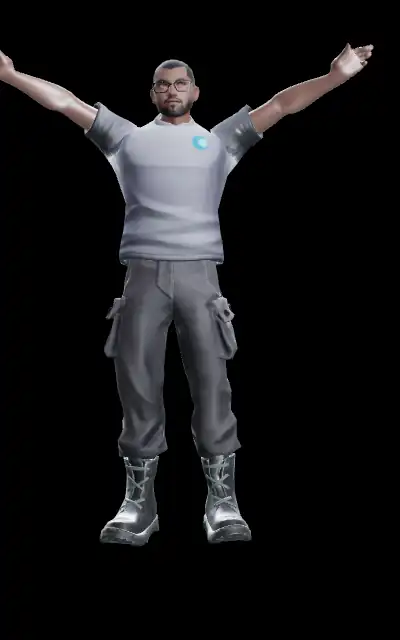 Waving — Brad (M·GLB)</td>
    <td align="center"> Clapping — Brad (M·GLB)</td>
    <td align="center"> Pointing-Forward — Brad (M·GLB)</td>
  </tr>
  <tr>
    <td align="center">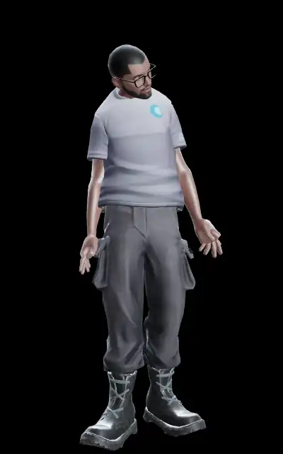 Agreeing — Brad (M·GLB)</td>
  </tr>
</table>

**expression**

<table>
  <tr>
    <td align="center">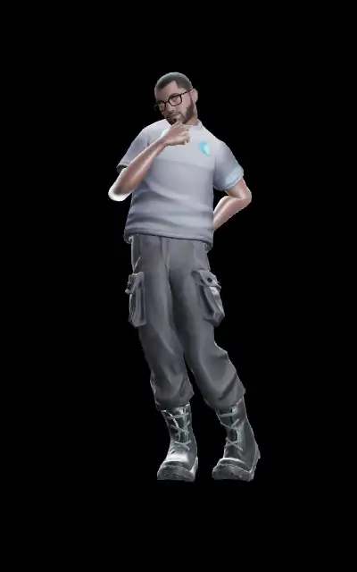 Thinking — Brad (M·GLB)</td>
    <td align="center"> Surprised — Brad (M·GLB)</td>
  </tr>
</table>

**action**

<table>
  <tr>
    <td align="center"> dance — Brad (M·GLB)</td>
    <td align="center"> bow — Brad (M·GLB)</td>
  </tr>
</table>

### Erik · M·VRM · 6

<table>
  <tr>
    <td align="center">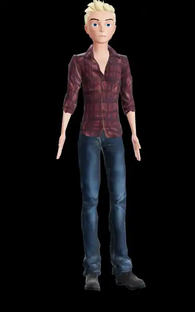 idle_loop — Erik (M·VRM)</td>
    <td align="center">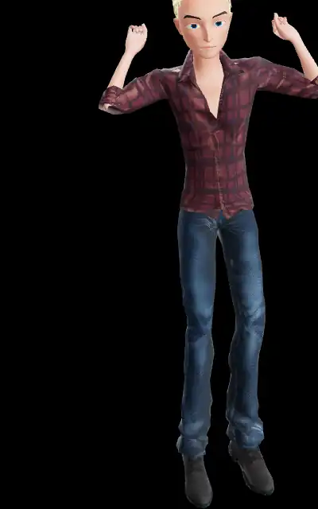 surprise_greet — Erik (M·VRM)</td>
    <td align="center">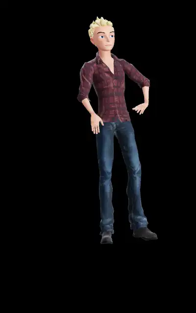 pose — Erik (M·VRM)</td>
  </tr>
  <tr>
    <td align="center">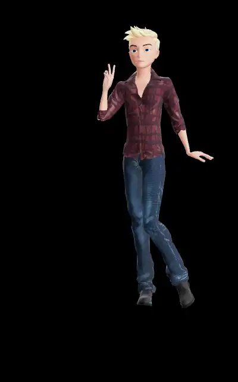 victory_sign — Erik (M·VRM)</td>
    <td align="center">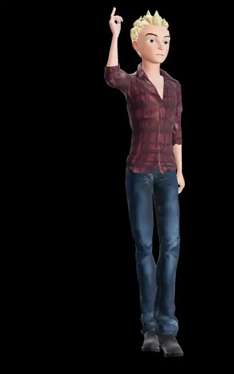 finger_gun — Erik (M·VRM)</td>
    <td align="center">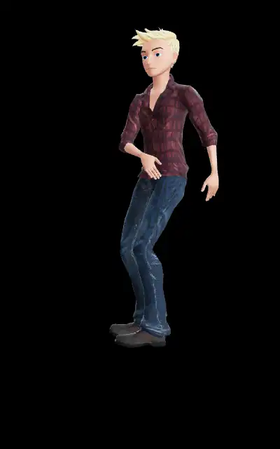 dance_move — Erik (M·VRM)</td>
  </tr>
</table>

### Yuki · F·VRM · 6

<table>
  <tr>
    <td align="center">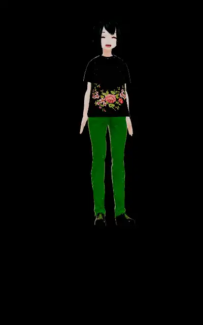 idle_loop — Yuki (F·VRM)</td>
    <td align="center">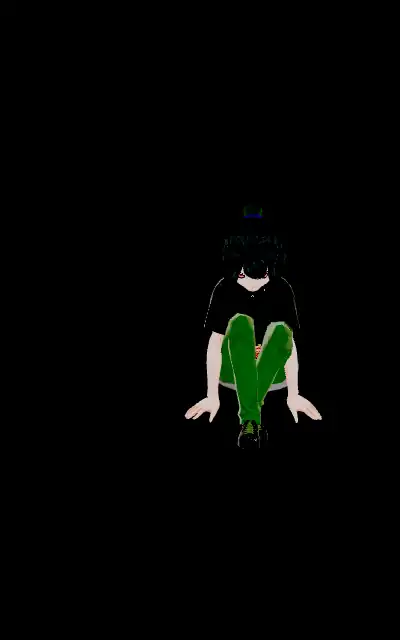 surprise_greet — Yuki (F·VRM)</td>
    <td align="center">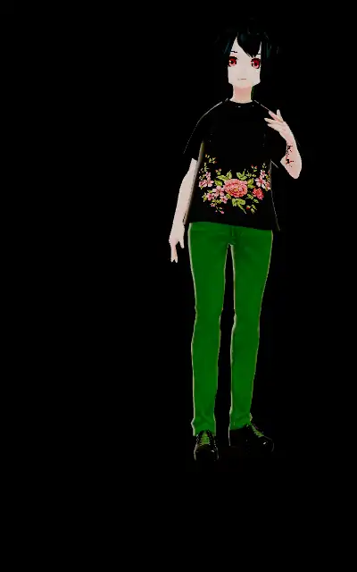 pose — Yuki (F·VRM)</td>
  </tr>
  <tr>
    <td align="center">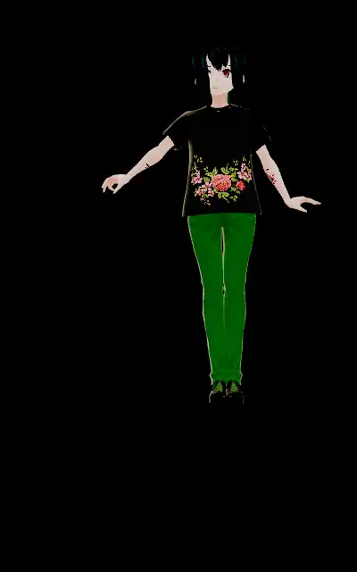 victory_sign — Yuki (F·VRM)</td>
    <td align="center">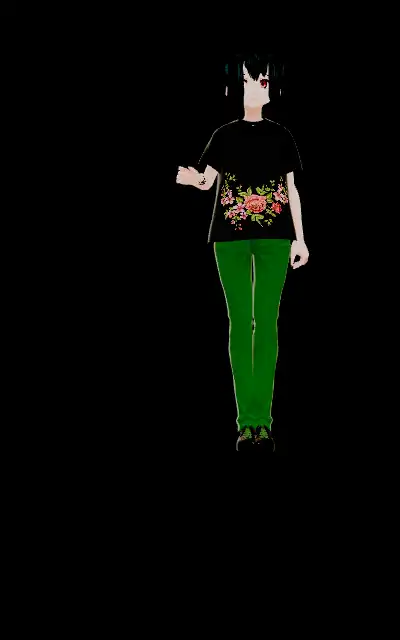 finger_gun — Yuki (F·VRM)</td>
    <td align="center">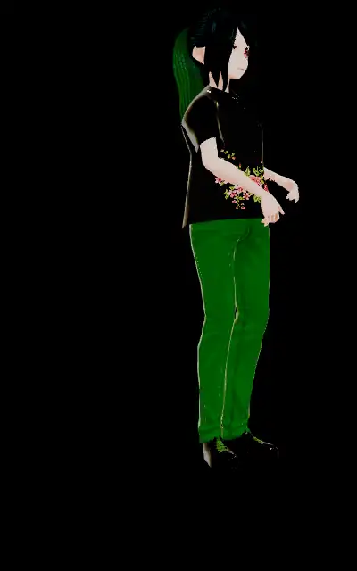 dance_move — Yuki (F·VRM)</td>
  </tr>
</table>

---
_Generated from `manifest.json` by `e2e/capture/gallery-md.mjs` at 10 fps._
