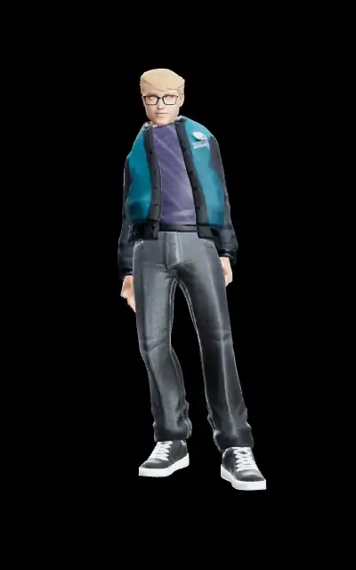
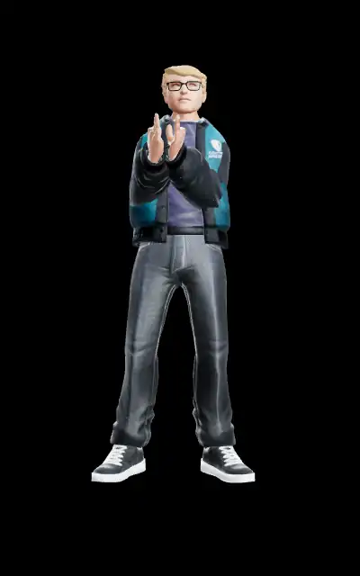
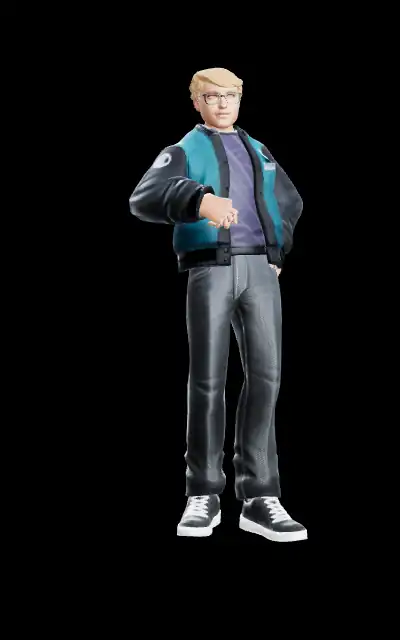
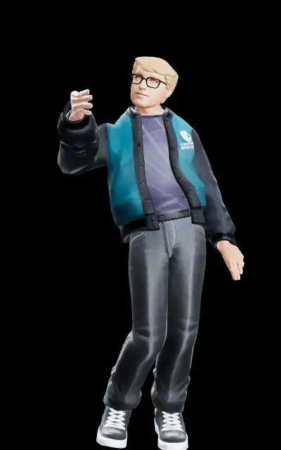
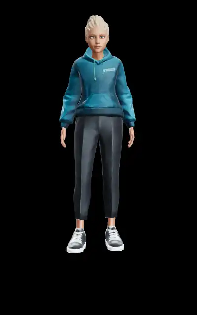

# Blend Combos · 5

Native crossfade transitions between clips (idle → gesture → idle, gesture → action, …).

← [back to gallery index](README.md)
<table>
  <tr>
    <td align="center"> idle → wave → idle (Greg)</td>
    <td align="center"> clap → bow (gesture→action) (Greg)</td>
    <td align="center"> think → talk (Greg)</td>
  </tr>
  <tr>
    <td align="center"> dance → idle (Greg)</td>
    <td align="center"> feminine idle → dance → idle (Cara)</td>
  </tr>
</table>

---
_Generated from `manifest.json` by `e2e/capture/gallery-md.mjs` at 10 fps._
