# Faces — Lip-sync & Emotes · 24

Viseme lip-sync + emotion expressions — GLB avatars (ARKit-52 morphs) and the expressive VRM avatars (Yuki, Kenji). Realistic VRM imports with empty expression binds are body-only.

← [back to gallery index](README.md)

### Greg · M·GLB · 6

**lipsync**

<table>
  <tr>
    <td align="center"> Lip-sync — Greg (M·GLB)</td>
  </tr>
</table>

**emote**

<table>
  <tr>
    <td align="center"> Emote: happy — Greg (M·GLB)</td>
    <td align="center">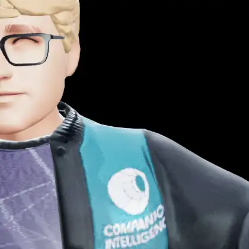 Emote: sad — Greg (M·GLB)</td>
    <td align="center"> Emote: angry — Greg (M·GLB)</td>
  </tr>
  <tr>
    <td align="center">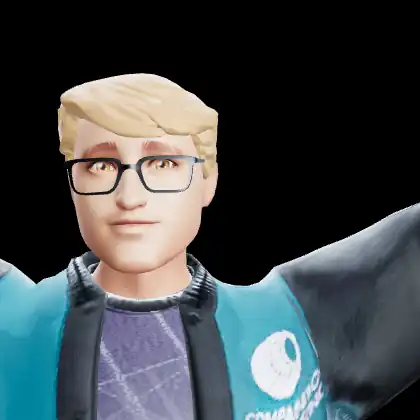 Emote: fear — Greg (M·GLB)</td>
    <td align="center"> Emote: love — Greg (M·GLB)</td>
  </tr>
</table>

### Cara · F·GLB · 6

**lipsync**

<table>
  <tr>
    <td align="center"> Lip-sync — Cara (F·GLB)</td>
  </tr>
</table>

**emote**

<table>
  <tr>
    <td align="center"> Emote: happy — Cara (F·GLB)</td>
    <td align="center">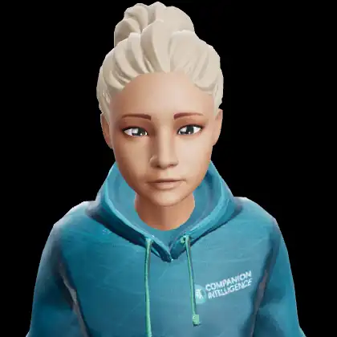 Emote: sad — Cara (F·GLB)</td>
    <td align="center">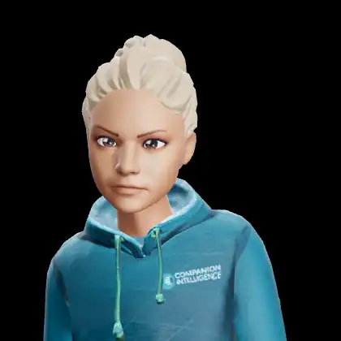 Emote: angry — Cara (F·GLB)</td>
  </tr>
  <tr>
    <td align="center"> Emote: fear — Cara (F·GLB)</td>
    <td align="center"> Emote: love — Cara (F·GLB)</td>
  </tr>
</table>

### Yuki · F·VRM · 6

**lipsync**

<table>
  <tr>
    <td align="center">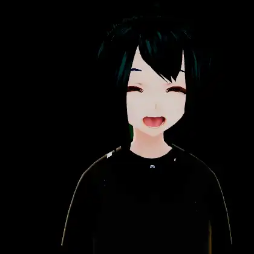 Lip-sync — Yuki (F·VRM)</td>
  </tr>
</table>

**emote**

<table>
  <tr>
    <td align="center">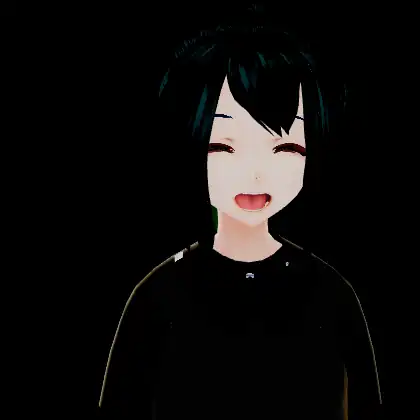 Emote: happy — Yuki (F·VRM)</td>
    <td align="center"> Emote: sad — Yuki (F·VRM)</td>
    <td align="center"> Emote: angry — Yuki (F·VRM)</td>
  </tr>
  <tr>
    <td align="center">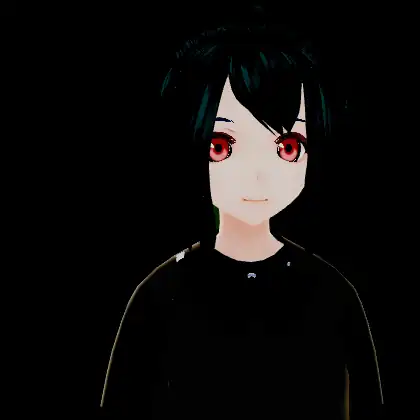 Emote: fear — Yuki (F·VRM)</td>
    <td align="center">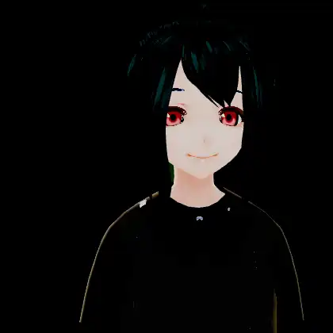 Emote: sleep — Yuki (F·VRM)</td>
  </tr>
</table>

### Kenji · M·VRM · 6

**lipsync**

<table>
  <tr>
    <td align="center">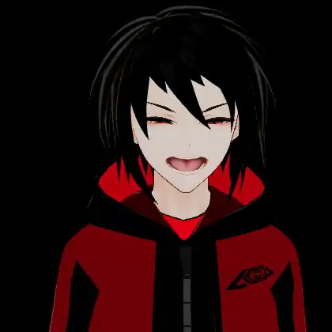 Lip-sync — Kenji (M·VRM)</td>
  </tr>
</table>

**emote**

<table>
  <tr>
    <td align="center"> Emote: happy — Kenji (M·VRM)</td>
    <td align="center"> Emote: sad — Kenji (M·VRM)</td>
    <td align="center">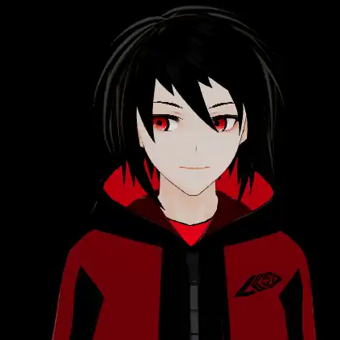 Emote: angry — Kenji (M·VRM)</td>
  </tr>
  <tr>
    <td align="center">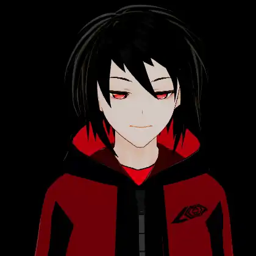 Emote: fear — Kenji (M·VRM)</td>
    <td align="center">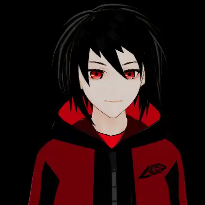 Emote: sleep — Kenji (M·VRM)</td>
  </tr>
</table>

---
_Generated from `manifest.json` by `e2e/capture/gallery-md.mjs` at 10 fps._
